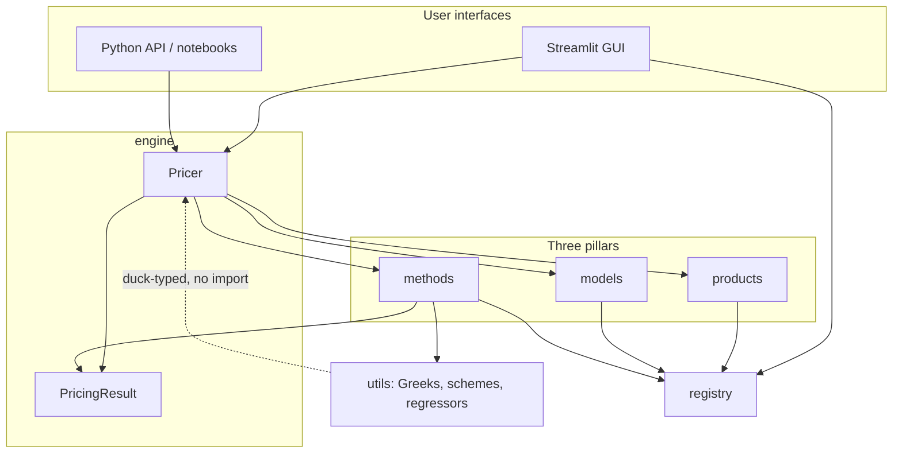
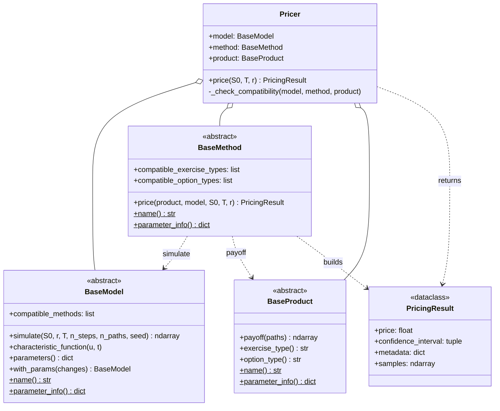
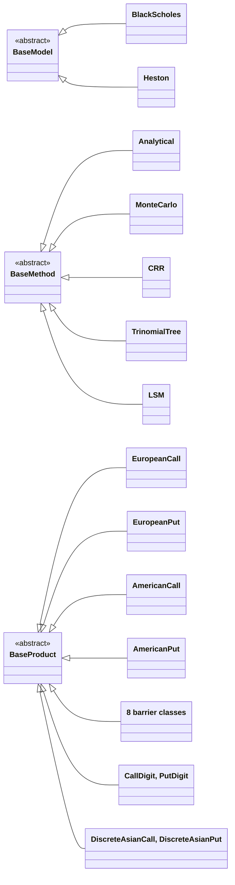
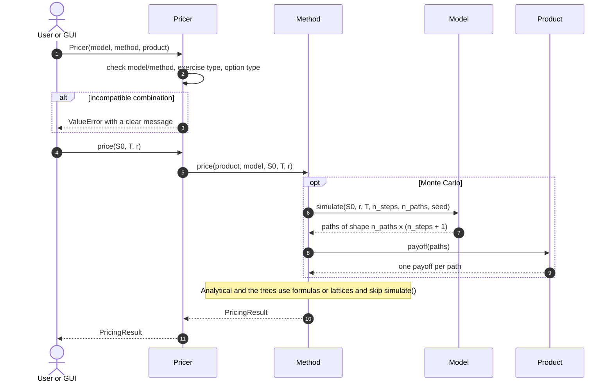
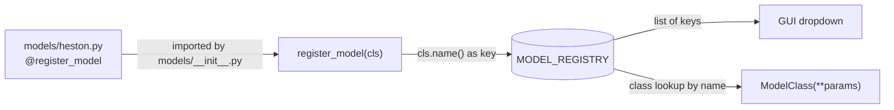
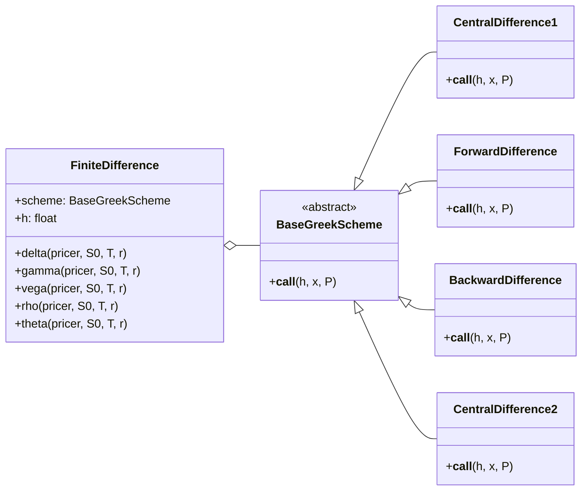
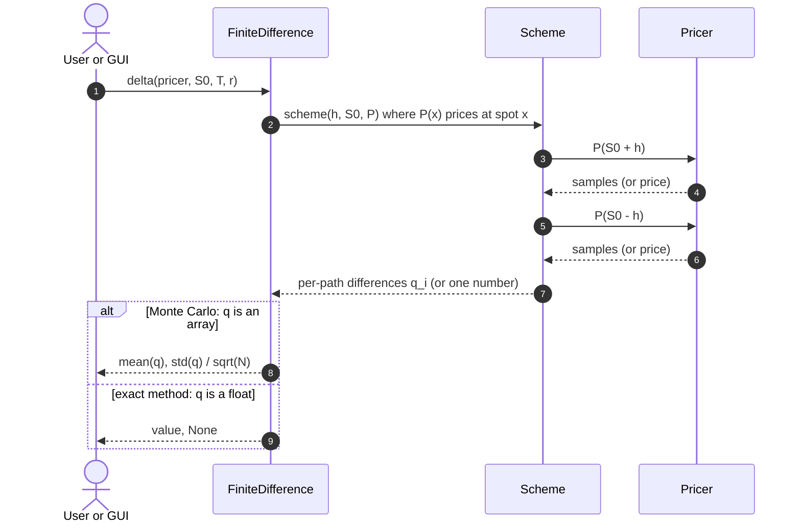

<div align="center">

# Premia Junior

**An educational, extensible derivatives-pricing library in Python.**
Add a model from a paper by writing *one file*.


</div>

Premia Junior is a Python re-imagining of Inria's **Premia** (a large pricing library written in C). It prices options with several models and numerical methods, computes Greeks with honest error bars, and ships with an interactive Streamlit GUI.

It is built as a learning project: every design choice is documented, and so are the **bugs we hit and how we fixed them** (see [Lessons learned](#7-lessons-learned-problems-we-hit-and-how-we-fixed-them)).

---

## Table of contents

1. [What's implemented](#1-whats-implemented)
2. [Quick start](#2-quick-start)
3. [Architecture (UML)](#3-architecture-uml)
4. [Design principles](#4-design-principles)
5. [Extending the library](#5-extending-the-library)
6. [Greeks and Monte Carlo error bars](#6-greeks-and-monte-carlo-error-bars)
7. [Lessons learned: problems we hit and how we fixed them](#7-lessons-learned-problems-we-hit-and-how-we-fixed-them)
8. [Validation](#8-validation)
9. [Known issues and roadmap](#9-known-issues-and-roadmap)
10. [Project structure](#10-project-structure)
11. [References](#11-references)

---

## 1. What's implemented

### Models

| Model | Dynamics | Simulation scheme | Compatible methods |
|-------|----------|-------------------|--------------------|
| `BlackScholes` | GBM, constant volatility | Euler, risk-neutral drift `r` | Analytical, CRR, TrinomialTree, Monte Carlo, LSM |
| `Heston` | Stochastic variance (CIR), correlated Brownian motions | Euler with full truncation, Feller check | Monte Carlo |

### Methods

| Method | Description |
|--------|-------------|
| `Analytical` | Closed-form Black-Scholes: vanilla call/put, digital, and the eight Reiner-Rubinstein barrier options |
| `Monte Carlo` | Path simulation with a 95% confidence interval; stores per-path values for Greek error bars |
| `CRR` | Cox-Ross-Rubinstein binomial tree, European and American |
| `TrinomialTree` | Kamrad-Ritchken trinomial tree, European and American |
| `LSM` | Longstaff-Schwartz for American options (Laguerre regression basis, configurable degree) |

### Products

| Family | Classes |
|--------|---------|
| European | `EuropeanCall`, `EuropeanPut` |
| American | `AmericanCall`, `AmericanPut` |
| Barrier (8) | `CallUpIn`, `CallUpOut`, `CallDownIn`, `CallDownOut`, `PutUpIn`, `PutUpOut`, `PutDownIn`, `PutDownOut` |
| Digital | `CallDigit`, `PutDigit` (cash-or-nothing) |
| Asian | `DiscreteAsianCall`, `DiscreteAsianPut` (arithmetic average over the simulation dates) |

### Which method prices which product?

Declared on the method classes and enforced by the `Pricer` (see [compatibility checks](#34-life-of-a-pricing-call)):

| Product family | Analytical | Monte Carlo | CRR | TrinomialTree | LSM |
|----------------|:----------:|:-----------:|:---:|:-------------:|:---:|
| European call / put | ✅ | ✅ | ✅ | ✅ | ❌ |
| American call / put | ❌ | ❌ | ✅ | ✅ | ✅ |
| Barrier (8 types) | ✅ | ✅ | ❌ | ❌ | ❌ |
| Digital | ✅ | ✅ | ❌ | ❌ | ❌ |
| Discrete Asian | ❌ | ✅ | ❌ | ❌ | ❌ |

`Analytical` only works with `BlackScholes`, and `Heston` only works with `Monte Carlo`.

### Greeks

Delta, gamma, vega, rho and theta by finite differences, with a pluggable differentiation scheme (forward, backward, central) and, for Monte Carlo pricers, a standard error computed path by path.

### GUI

- **Pricing page:** pick model, method and product, fill in parameters, get the price, confidence interval, simulated paths and (optionally) Greeks.
- **Compare Methods page:** price the same option with several methods side by side, with per-method parameters and Greeks.

---

## 2. Quick start

### Install

The project is not pip-installable yet (see the [roadmap](#9-known-issues-and-roadmap)). Clone it and run from the repository root:

```bash
git clone https://github.com/Youssef-Kallala/premia-junior.git
cd premia-junior
pip install numpy scipy matplotlib pandas streamlit
```

Python 3.11 or newer is required (`match` statements and `X | None` type hints).

### Price an option

```python
from premia_junior.models.black_scholes import BlackScholes
from premia_junior.methods.monte_carlo import MonteCarlo
from premia_junior.products.european import EuropeanCall
from premia_junior.engine.pricer import Pricer

model   = BlackScholes(mu=0.05, sigma=0.2)
method  = MonteCarlo(n_paths=100_000, n_steps=252, seed=42)
product = EuropeanCall(K=100)

result = Pricer(model=model, method=method, product=product).price(S0=100, T=1.0, r=0.05)
print(result.price)                # ~10.48
print(result.confidence_interval)  # ~(10.39, 10.57)
```

Swapping the model, method or product never touches the rest of the code:

```python
from premia_junior.models.heston import Heston
model = Heston(v0=0.04, kappa=1.5, theta=0.04, xi=0.3, rho=-0.7)   # same pricer, new dynamics
```

An invalid combination fails immediately with a readable message:

```python
from premia_junior.methods.analytical import Analytical
from premia_junior.products.american import AmericanPut

Pricer(model=BlackScholes(mu=0.05, sigma=0.2), method=Analytical(), product=AmericanPut(K=100))
# ValueError: Analytical does not support american options.
```

### Compute Greeks

```python
from premia_junior.utils.greek import FiniteDifference
from premia_junior.utils.BaseGreekScheme import CentralDifference1

pricer = Pricer(model=model, method=MonteCarlo(100_000, 252, seed=42), product=product)
fd = FiniteDifference(CentralDifference1(), h=0.01)

delta, err = fd.delta(pricer, S0=100, T=1.0, r=0.05)   # err is None for exact methods
print(f"delta = {delta:.4f} +/- {1.96 * err:.4f}")
```

Every Greek returns `(value, standard_error)`. The error is `None` for deterministic methods (Analytical, trees) and a real standard error for Monte Carlo.

### Run the GUI

```bash
streamlit run gui/app.py
```

---

## 3. Architecture (UML)

The diagrams below are Mermaid, so they render directly on GitHub.

### 3.1 Layers and the one-way dependency rule

A file may only import from layers **below** it. This rules out circular imports by construction.



### 3.2 Core contracts

Every model, method and product inherits from an abstract base class. Python refuses to instantiate a class that forgets part of the contract, so mistakes surface immediately instead of as silently wrong prices.



### 3.3 Implemented classes



### 3.4 Life of a pricing call

Three independent compatibility checks run when the `Pricer` is built, before any computation starts:

1. **model and method:** is the method listed in `model.compatible_methods`?
2. **method and exercise type:** is `product.exercise_type()` in `method.compatible_exercise_types`?
3. **method and payoff family:** is `product.option_type()` in `method.compatible_option_types`?



### 3.5 The registry: how a new class appears everywhere



A decorator such as `@register_model` runs once, when Python imports the file. It stores the **class** (not an instance) under `cls.name()` and returns the class unchanged. The GUI builds its dropdowns from the registry keys and its parameter inputs from `parameter_info()`, so a new model needs no GUI code.

### 3.6 Greeks: the Strategy pattern

The differentiation scheme is the part that varies, so it is a pluggable object.



How one Greek is computed, and where the error bar comes from:



---

## 4. Design principles

### The rule behind every decision: what is fixed, what varies?

| Object | Fixed at construction (`__init__`) | Varies per call |
|--------|------------------------------------|-----------------|
| Model | its parameters (`sigma`, `kappa`, ...) | `S0`, `T`, `r`, `n_steps`, `n_paths`, `seed` |
| Method | its settings (`n_paths`, `n_steps`, `degree`, `seed`) | model, product, `S0`, `T`, `r` |
| Product | strike, barrier, payout | the simulated paths |
| Pricer | model, method, product | `S0`, `T`, `r` |
| FiniteDifference | scheme, bump size `h` | pricer, evaluation point |

Whenever something varies between papers, it becomes a pluggable object instead of an `if` branch:

| What varies | Pluggable piece |
|-------------|-----------------|
| Asset dynamics | `BaseModel` subclasses |
| Numerical solver | `BaseMethod` subclasses |
| Payoff | `BaseProduct` subclasses |
| Differentiation scheme | `BaseGreekScheme` subclasses |
| Regression basis in LSM | passed to the method |

### Patterns used (and the names they go by)

| Where | Pattern |
|-------|---------|
| Greek schemes, LSM regression basis | **Strategy** |
| `BaseModel`, `BaseMethod`, `BaseProduct` | **Interface (abstract base class)** |
| Model x Method x Product plugged together in `Pricer` | **Composition over inheritance** (close to Bridge) |
| `Pricer` | **Facade** with built-in validation |
| Registry plus `ModelClass(**params)` | **Registry** and **Factory** |
| `model.with_params(sigma=...)` | **Wither** (copy-and-modify on an immutable-style object) |

`@register_model` is Python's decorator *syntax*, but it is not the GoF Decorator pattern.

### Other choices

- **Pricing and Greeks are separate.** `PricingResult` carries no Greeks, so you only pay for what you ask for.
- **`r` stays a plain float.** A non-constant rate (Hull-White, a yield curve) is a good future extension, but we followed YAGNI and did not build it before it was needed.
- **Vectorised payoffs.** `payoff(paths)` takes the whole `(n_paths, n_steps + 1)` array and returns one value per path, so there are no Python loops over paths.
- **Reproducibility.** Every random draw comes from `np.random.default_rng(seed)`.

---

## 5. Extending the library

### Add a model: one file and one import line

```python
# premia_junior/models/your_model.py
from ..registry import register_model
from .base import BaseModel
import numpy as np

@register_model
class YourModel(BaseModel):
    compatible_methods = ["Monte Carlo"]

    def __init__(self, param1: float, param2: float):
        self.param1, self.param2 = param1, param2

    def simulate(self, S0, r, T, n_steps, n_paths, seed=None) -> np.ndarray:
        rng = np.random.default_rng(seed)
        paths = np.zeros((n_paths, n_steps + 1))
        paths[:, 0] = S0
        # ... discretise your SDE under the risk-neutral measure (drift r) ...
        return paths

    def parameters(self) -> dict:
        # keys MUST equal the __init__ argument names (with_params relies on it)
        return {"param1": self.param1, "param2": self.param2}

    @classmethod
    def name(cls) -> str:
        return "YourModel"

    @classmethod
    def parameter_info(cls) -> dict:
        return {
            "param1": {"default": 0.5, "min": 0.0, "max": 5.0, "step": 0.01},
            "param2": {"default": 0.1, "min": 0.0, "max": 1.0, "step": 0.01},
        }
```

Then add `from .your_model import YourModel` to `premia_junior/models/__init__.py`. The model now appears in the registry, the GUI dropdown and the compatibility checker. Nothing else changes.

### Add a method

```python
@register_method
class YourMethod(BaseMethod):
    compatible_exercise_types = ["european"]        # class attributes, NOT inside __init__
    compatible_option_types   = ["call", "put"]

    def __init__(self, your_param: int): ...
    def price(self, product, model, S0, T, r) -> PricingResult: ...
    @classmethod
    def name(cls) -> str: return "YourMethod"
    @classmethod
    def parameter_info(cls) -> dict: ...
```

If your method is simulation-based, fill `PricingResult.samples` with the discounted per-path values so that Greeks get an error bar automatically.

### Add a product

Same pattern. Return `"european"` or `"american"` from `exercise_type()`, and one of `"call"`, `"put"`, `"barrier"`, `"digital"`, `"asian"` from `option_type()`.

### Add a Greek scheme

Subclass `BaseGreekScheme` and implement `__call__(self, h, x, P)`.

---

## 6. Greeks and Monte Carlo error bars

Finite-difference Greeks look easy, but on a Monte Carlo price they hide a trap. The experiment below uses `S0 = K = 100`, `T = 1`, `r = 5%`, `sigma = 20%`, 100,000 paths and `h = 0.01`.

| | Closed form | MC, `seed=42` | MC, `seed=None` |
|---|:---:|:---:|:---:|
| delta | 0.6368 | 0.6376 | **1.608** |
| gamma | 0.01876 | 0.01714 | **-438.9** |

### Why `seed=None` explodes

With independent random numbers, each Monte Carlo price is the true price plus noise of standard error `s` (about 0.047 here). Differencing two independent prices and dividing by `h` amplifies that noise:

- delta: `std ~ sqrt(2) * s / (2h)`, about 3
- gamma: `std ~ sqrt(6) * s / h^2`, about 10^3

The noise grows like `1/h` for delta and `1/h^2` for gamma, while the finite-difference bias only shrinks like `h^2`. So there is a bias-variance trade-off in `h`.

### The fix: common random numbers (CRN) and per-path differences

Using the same seed for every bumped price makes the two simulations share their noise, so it cancels in the difference. Write `X_i(x)` for the discounted payoff of path `i` when the spot is `x`. The Greek is then a plain average of per-path differences:

$$
\hat\Delta = \frac1N\sum_{i=1}^N q_i,\qquad q_i=\frac{X_i(S_0+h)-X_i(S_0-h)}{2h},\qquad \mathrm{SE}=\frac{\mathrm{std}(q)}{\sqrt N}
$$

To make that possible, `MonteCarlo` stores the `X_i` in `PricingResult.samples`. `FiniteDifference` applies the scheme to those arrays (the schemes only use `+`, `-`, `*`, so they work on arrays unchanged) and returns `(mean, std/sqrt(N))`. Exact methods leave `samples = None` and get `(value, None)`.

Two consequences worth knowing:

- **A fixed seed is reproducible, not accurate.** It makes the result repeatable. The error bar tells you how accurate it is.
- **With CRN the trade-off depends on the payoff.** For a call, delta has bounded per-path quotients and needs no trade-off, but gamma only receives contributions from paths ending within about `h` of the strike, so it stays noisy (9% off in the table above). For digital payoffs even delta is problematic. Pathwise and likelihood-ratio estimators, which have no bump size at all, are on the roadmap.

---

## 7. Lessons learned: problems we hit and how we fixed them

This section is the honest history of the project. Most of these bugs were silent: the code ran and returned plausible-looking numbers.

### 7.1 Architecture and registry

| # | Problem | Cause | Fix |
|---|---------|-------|-----|
| 1 | Registry crashed with `missing argument 'K'` | The decorator did `Product()` to read the name, but products need a strike | `name()` is a `@classmethod`; the registry never instantiates anything |
| 2 | Decorated class turned into a dict | The decorator returned `MODEL_REGISTRY` instead of the class | A decorator must return the class it received |
| 3 | Models overwrote each other in the registry | Copy-paste: all barrier classes returned `"CallUpIn"` from `name()`; `register_method` wrote into `MODEL_REGISTRY` | Unique names, correct target dictionary |
| 4 | A new model was missing from the GUI | The registry only knows files that were imported | One import line per class in the pillar's `__init__.py` |
| 5 | `ModuleNotFoundError: premia_junior` in notebooks and Streamlit | `sys.path` was fixed *after* the imports that needed it | Set the path first, using `Path(__file__).resolve().parents[1]`; the lasting fix is `pip install -e .` |
| 6 | Risk of circular imports | Layers importing each other | One-way dependency rule (section 3.1) |

### 7.2 Modelling and numerics

| # | Problem | Cause | Fix |
|---|---------|-------|-----|
| 7 | Monte Carlo prices depended on the real-world drift `mu` | Simulating under `mu` instead of the risk-neutral drift `r` | `simulate(S0, r, T, ...)`: the drift under the pricing measure is `r`. Discounting still belongs to the method |
| 8 | Paths had the wrong variance | Diffusion scaled by `dt` instead of `sqrt(dt)`; unseeded `np.random` | Draw all normals up front with `default_rng(seed)` and scale by `sqrt(dt)` |
| 9 | Heston: negative variance | Plain Euler on a CIR process | Full truncation (`V+ = max(V, 0)` inside the drift and the square root) |
| 10 | Heston's Feller warning only appeared in the terminal | `print` in `__init__` never reaches the browser | Surface it as data the GUI can display |
| 11 | CRR wrong prices | `N` terminal nodes instead of `N+1`; `np.max` instead of `np.maximum`; missing discounting; intrinsic value computed on the wrong number of nodes | Fixed each; validated against the analytical European price |
| 12 | LSM gave 5.98 against 6.46 from CRR | Cash flows discounted by the wrong amount (once too often, then by `T` instead of by the exercise date) | Track each path's exercise time and discount by it. CRR served as the benchmark that exposed the bug |
| 13 | Barrier prices wrong | The strike was used as the barrier; knock-out conditions had the wrong direction | Separate parameters `K` and `B`; conditions rewritten per type |
| 14 | Digital payoff wrong | Call/put conditions swapped; payout `Q` forgotten; payoff was boolean, not float | `Q * (S_T > K).astype(float)` |
| 15 | Silent failures from string mismatches | `"European"` versus `"european"` | One lowercase vocabulary for exercise types |

### 7.3 Compatibility checks

| # | Problem | Cause | Fix |
|---|---------|-------|-----|
| 16 | Monte Carlo priced an American put *as a European put* with no error | Nothing stopped an unsupported pairing | Three explicit checks in `Pricer` (section 3.4) |
| 17 | The new checks did nothing | The `compatible_*` lists were local variables inside `__init__`, and one had a typo (`compatible_option_type`), so `hasattr` was always false | Declare them as class attributes with the exact names, and add the missing third check |
| 18 | One method served two meanings | `option_type()` mixed payoff family, specific barrier name and exercise style | Split: `exercise_type()` is `european`/`american`; `option_type()` is `call`/`put`/`digital`/`barrier`/`asian` |
| 19 | Ugly red traceback in the GUI | Errors propagated | Catch `ValueError` and show the message |

### 7.4 Greeks

| # | Problem | Cause | Fix |
|---|---------|-------|-----|
| 20 | Vega needs a different model, not a different argument | `sigma` lives inside the model object | `model.with_params(sigma=x)` returns a modified copy |
| 21 | `with_params` crashed with a `TypeError` | `parameters()` returned `"drift"` while `__init__` takes `mu` | Rule: the keys of `parameters()` equal the constructor argument names |
| 22 | Monte Carlo delta 1.6, gamma -439 | Independent random numbers per bumped price | Common random numbers (section 6) |
| 23 | Greeks with no uncertainty are meaningless | Only the mean was kept | Per-path values in `PricingResult.samples`, error = `std/sqrt(N)` |
| 24 | Exact methods looked random | `samples` defaulted to an empty array, so "has no samples" could not be detected | Default is `None`, and the field is hidden from `repr` |
| 25 | Rho 52.48 and vega 37.13 instead of 53.23 and 37.52 | One bump `h = 0.1` for variables of very different scale (`S0 = 100`, `sigma = 0.2`, `r = 0.05`) | Use a small `h` for now; per-variable bumps are on the roadmap |

### 7.5 Tooling gotchas

- **Jupyter keeps old modules in memory.** Re-running a cell does not reload edited files. Restart the kernel, or use `%load_ext autoreload` and `%autoreload 2`.
- **Streamlit needs a full restart** to see a new page or a changed import.
- **A new Streamlit page must live in `gui/pages/`** to appear in the sidebar.

---

## 8. Validation

Parameters unless stated: `S0 = K = 100`, `T = 1`, `r = 5%`, `sigma = 20%`.

| Check | Result |
|-------|--------|
| European call, Analytical | 10.4506 |
| Same call, Monte Carlo (100k paths, seed 42) | 10.4833, 95% CI [10.3914, 10.5751], which contains 10.4506 |
| European put, Analytical and CRR (500 steps) | 5.5735 and 5.5695 |
| Put-call parity | C - P = 4.877 = S0 - K e^(-rT) |
| American put, CRR | 6.4597, above the European put as expected |
| Heston call (v0 = theta = 0.04, kappa = 1.5, xi = 0.3, rho = -0.7), Monte Carlo | 10.318, 95% CI [10.244, 10.392] |
| Black-Scholes Greeks, central differences, `h = 0.01` | delta 0.6368, gamma 0.01876, vega 37.52, rho 53.23, theta -6.414 (all match the closed forms) |

---

## 9. Known issues and roadmap

### Known issues

- **`CallUpIn` analytical price.** A negative price (-5.57) was observed for this product, so the Reiner-Rubinstein implementation is not fully validated. Until it is, use Monte Carlo as the reference for barrier options.
- **Barrier monitoring differs between methods.** The closed forms assume continuous monitoring, while Monte Carlo checks the barrier at the simulation dates, so the two differ by a discretisation bias that shrinks as `n_steps` grows.
- **LSM** is a low-biased estimator by construction. After the discounting fix it should be re-checked against CRR (6.4597 for the American put above).
- **One bump size `h`** is used for every Greek, and `gamma` always uses the central second-difference scheme regardless of the selected scheme.
- **Vega is only defined for models with a `sigma`.** What vega means for Heston is still to be decided.
- **Finite-difference Greeks on digital and barrier payoffs with Monte Carlo are unreliable.**
- `BlackScholes.compatible_methods` lists `FDM` and `FFT`, which are not implemented yet.
- **No automated test suite yet.** Validation has been done in notebooks against closed forms and cross-method comparisons.
- Constant interest rate only; no calibration to market data; single underlying only.

### Roadmap

- [ ] `pyproject.toml` and `pip install -e .`
- [ ] Automated tests (`pytest`) built from the validation table above
- [ ] Enforce common random numbers inside `FiniteDifference`, so forgetting a seed cannot produce garbage
- [ ] Per-variable bump sizes, and separate first- and second-derivative schemes
- [ ] Analytical Greeks for Black-Scholes (call, put)
- [ ] Pathwise and likelihood-ratio Greek estimators (valid for different payoffs; see section 6)
- [ ] Heston characteristic function and an FFT/COS method
- [ ] Local volatility (CEV or Dupire) as a new model
- [ ] Convergence page in the GUI
- [ ] Calibration to implied-volatility surfaces

---

## 10. Project structure

```
premia-junior/
├── premia_junior/
│   ├── __init__.py
│   ├── registry.py              # three dictionaries and three decorators
│   ├── products/
│   │   ├── base.py              # BaseProduct (ABC)
│   │   ├── european.py
│   │   ├── american.py
│   │   ├── barrier.py
│   │   ├── digital.py
│   │   └── asian.py
│   ├── models/
│   │   ├── base.py              # BaseModel (ABC), with_params
│   │   ├── black_scholes.py
│   │   └── heston.py
│   ├── methods/
│   │   ├── base.py              # BaseMethod (ABC)
│   │   ├── analytical.py
│   │   ├── monte_carlo.py
│   │   ├── crr.py
│   │   ├── trinomial.py
│   │   └── lsm.py
│   ├── engine/
│   │   ├── pricer.py            # Pricer: orchestrator and compatibility checks
│   │   └── result.py            # PricingResult
│   └── utils/
│       ├── BaseGreekScheme.py   # schemes (Strategy)
│       └── greek.py             # FiniteDifference
├── gui/
│   ├── app.py                   # pricing page
│   └── pages/
│       └── 01_Compare_Methods.py
├── notebooks/                   # validation experiments
├── tests/                       # (to come)
└── README.md
```

---

## 11. References

- J. C. Cox, S. A. Ross, M. Rubinstein (1979). *Option pricing: a simplified approach.* Journal of Financial Economics 7(3).
- B. Kamrad, P. Ritchken (1991). *Multinomial approximating models for options with k state variables.* Management Science 37(12).
- F. A. Longstaff, E. S. Schwartz (2001). *Valuing American options by simulation: a simple least-squares approach.* Review of Financial Studies 14(1).
- S. L. Heston (1993). *A closed-form solution for options with stochastic volatility with applications to bond and currency options.* Review of Financial Studies 6(2).
- E. Reiner, M. Rubinstein (1991). *Breaking down the barriers.* Risk 4(8).
- L. Andersen (2008). *Efficient simulation of the Heston stochastic volatility model.* Journal of Computational Finance 11(3). (Quadratic-Exponential scheme, a possible upgrade over Euler truncation.)
- P. Glasserman (2004). *Monte Carlo Methods in Financial Engineering.* Springer. Chapter 7 covers sensitivities: finite differences, common random numbers, pathwise and likelihood-ratio methods.
- Inria **Premia**, the C library that inspired this project.

---

## License

MIT